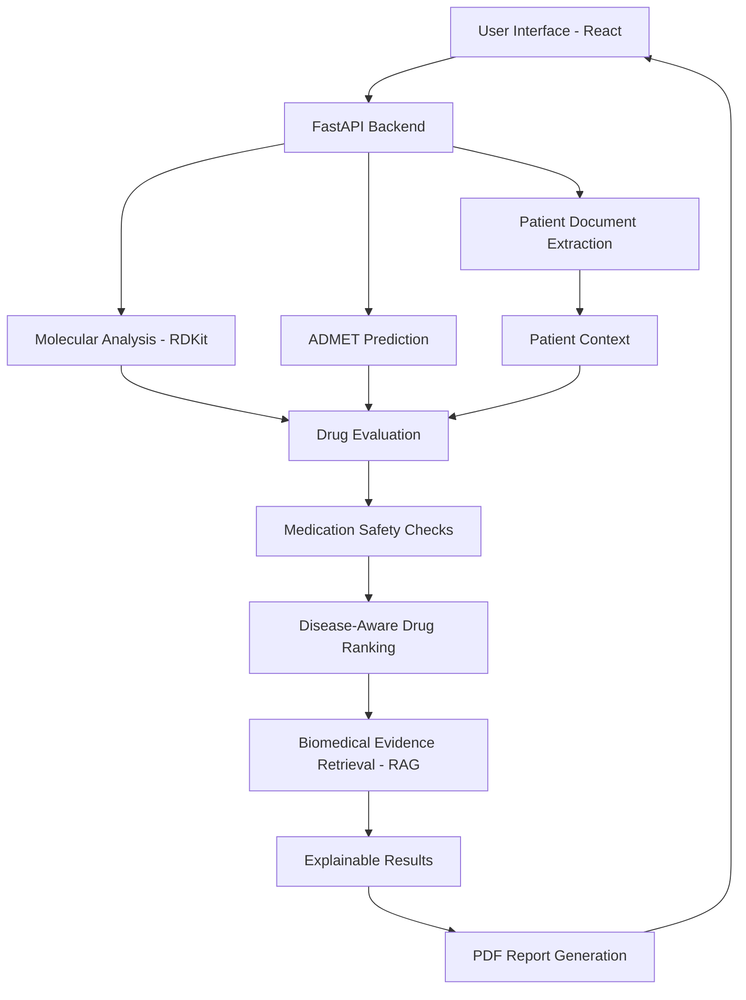

# 💊 SafeRx AI – AI-Powered Medication Safety & Prescription Analysis

<p align="center">
  An AI-powered research and decision-support prototype for medication analysis, molecular insights, patient-context extraction, and evidence-based drug evaluation.
</p>

<p align="center">
  <b>React · FastAPI · Python · RDKit · ADMET-AI · RAG · Machine Learning</b>
</p>

---

## 📌 Overview

**SafeRx AI** is an AI-powered medication safety and prescription analysis system designed to support medication evaluation through molecular analysis, patient-context extraction, biomedical evidence retrieval, and explainable drug ranking.

The platform combines computational drug analysis with biomedical information retrieval to provide structured insights into drug properties, potential safety concerns, and patient-specific medication considerations.

It is developed as an educational and research-oriented prototype exploring the application of Artificial Intelligence, Machine Learning, Natural Language Processing, and cheminformatics in healthcare technology.

## 🎯 Project Objectives

- Analyze molecular structures and chemical properties of drugs.
- Evaluate computational ADMET properties.
- Extract relevant information from patient medical documents.
- Identify potential medication safety concerns.
- Retrieve biomedical evidence from available sources.
- Provide disease-aware drug ranking with transparent scoring.
- Generate explainable analysis and downloadable PDF reports.

## ✨ Key Features

### 1. Drug Recommendation & Safety Analysis
- Patient-context-based drug evaluation.
- Allergy and comorbidity checks.
- Medication safety considerations.
- Disease and condition-aware ranking.
- Transparent ranking weights and explanations.

### 2. Molecular Analysis
- Molecular structure parsing using RDKit.
- Chemical descriptor calculations.
- Molecular structure visualization.
- Detailed molecular information.

### 3. ADMET Prediction
- Pretrained ADMET-AI inference when available.
- Computational evaluation of absorption, distribution, metabolism, excretion, and toxicity.
- Detailed ADMET information.

### 4. Patient Document Extraction
- Upload patient documents in PDF, JPG, JPEG, PNG, and WEBP formats.
- Extract information from searchable PDFs.
- OCR-based extraction for scanned PDFs and images.
- Tesseract OCR integration.
- Editable patient information before drug ranking.

### 5. Biomedical Evidence Retrieval
- Retrieval-Augmented Generation (RAG).
- BioLinkBERT and FAISS when available.
- TF-IDF fallback mechanism.
- Optional PubChem, PubMed, and openFDA enrichment.
- Drug-specific deduplicated evidence retrieval.

### 6. Explainable AI
- Explainability linked to selected drug recommendations.
- Transparent ranking information.
- Structured drug evaluation results.

### 7. Report Generation
The application provides two report types:

1. Patient + Drug Recommendation Report.
2. Molecule / ADMET Report.

Reports can be generated in PDF format.

### 8. User Interface
- React-based interactive dashboard.
- Persistent dark and light themes.
- Responsive interface.
- Data visualization using Recharts.
- Animated UI components.

## 🛠️ Technology Stack

| Category | Technologies |
|---|---|
| Frontend | React.js, Vite |
| Styling | Tailwind CSS |
| UI Animation | Framer Motion |
| Icons | Lucide React |
| Data Visualization | Recharts |
| Backend | Python, FastAPI |
| API Server | Uvicorn |
| Cheminformatics | RDKit |
| ADMET Prediction | ADMET-AI |
| NLP | BioLinkBERT |
| RAG | FAISS, TF-IDF |
| Machine Learning | Scikit-learn, XGBoost |
| Document Processing | PyMuPDF, PyPDF |
| OCR | Tesseract, Pytesseract |
| Data Processing | Pandas, NumPy |
| Report Generation | ReportLab |
| Biomedical Sources | PubChem, PubMed, openFDA |

## 🏗️ System Architecture



## 📂 Project Structure

```text
SafeRx-AI/
│
├── backend/
│   ├── api.py
│   ├── saferx_complete.py
│   ├── requirements.txt
│   └── synthetic_medical_reports_1000 (1).csv
│
├── frontend/
│   ├── src/
│   │   ├── App.jsx
│   │   ├── main.jsx
│   │   └── index.css
│   ├── package.json
│   ├── index.html
│   └── vite.config.js
│
├── README.md
├── PROJECT_SPECIFICATION.txt
├── FINAL_VERSION.txt
├── START_BACKEND.bat
├── START_FRONTEND.bat
├── run_all.bat
├── install_ocr_windows.bat
└── .gitignore
```

## ⚙️ Installation & Setup

### Prerequisites

Install the following before running the application:

- Python 3.10 or a compatible version for the dependencies.
- Node.js and npm.
- Git.
- Tesseract OCR (for image and scanned-document extraction).

### Step 1: Clone the Repository

```bash
git clone https://github.com/chinmayranjanranjan-art/SafeRx-AI.git
```

```bash
cd SafeRx-AI
```

### Step 2: Set Up the Backend

Open the first terminal:

```powershell
python -m venv .venv
```

Activate the virtual environment:

```powershell
.\.venv\Scripts\Activate.ps1
```

Install dependencies:

```powershell
python -m pip install --upgrade pip
pip install -r backend\requirements.txt
```

Start the backend:

```powershell
python -m uvicorn backend.api:app --reload --host 127.0.0.1 --port 8000
```

Backend address:

`http://127.0.0.1:8000`

### Step 3: Set Up the Frontend

Open a second terminal:

```powershell
cd frontend
```

Install dependencies:

```bash
npm install
```

Start the frontend:

```bash
npm run dev
```

Open the local Vite URL, normally:

`http://127.0.0.1:5173/`

### Step 4: Optional OCR Installation

For scanned documents and image-based patient information, install Tesseract OCR:

```powershell
winget install --id UB-Mannheim.TesseractOCR -e
```

Alternatively, run:

```powershell
.\install_ocr_windows.bat
```

### Step 5: Optional Live Biomedical Enrichment

The application supports optional external biomedical enrichment.

To enable it in PowerShell before starting the backend:

```powershell
$env:SAFERX_LIVE_ENRICH="1"
```

This enables optional PubChem, PubMed, and openFDA enrichment.

The default configuration supports offline/fallback operation.

## 🔗 Main API Endpoints

| Method | Endpoint | Purpose |
|---|---|---|
| GET | `/api/health` | Backend health check |
| POST | `/api/initialize` | Initialize application |
| POST | `/api/molecule/analyze` | Molecular analysis |
| POST | `/api/recommend` | Drug recommendation |
| POST | `/api/evidence` | Biomedical evidence retrieval |
| POST | `/api/report/analyze` | Patient document extraction |
| GET | `/api/dashboard` | Dashboard information |
| GET | `/api/evaluation` | Evaluation information |
| GET | `/api/explain/{drug}` | Drug explanation |
| POST | `/api/report/pdf` | PDF report generation |

## 🔬 Scientific Limitations & Disclaimer

SafeRx AI is an educational and research-oriented decision-support prototype.

- ADMET results are computational predictions, not laboratory measurements.
- RAG evidence confidence does not represent clinical certainty.
- Synthetic patient data is identified as synthetic.
- Drug ranking is intended for research and educational evaluation, not as a prescription.
- The application must not replace qualified medical professionals.
- Pretrained models used by the application are not claimed to have been trained by this project.
- Missing information should not be interpreted as proof of safety.

**Important:** This application is not intended for independent diagnosis, treatment selection, or real-world prescribing.

## 🚀 Future Enhancement Opportunities

- Integration with additional verified biomedical databases.
- Expanded drug interaction analysis.
- Improved patient-document extraction.
- Additional molecular prediction models.
- Enhanced model evaluation and validation.
- Deployment with secure authentication and data protection.

## 👨‍💻 Project Information

**Project:** SafeRx AI  
**Domain:** Artificial Intelligence in Healthcare  
**Focus Areas:** Drug Safety, Molecular Analysis, ADMET Prediction, RAG, Explainable AI.

**GitHub Repository:**  
https://github.com/chinmayranjanranjan-art/SafeRx-AI

---

<p align="center">
  <b>SafeRx AI – Exploring AI for Safer Medication Evaluation.</b>
</p>
